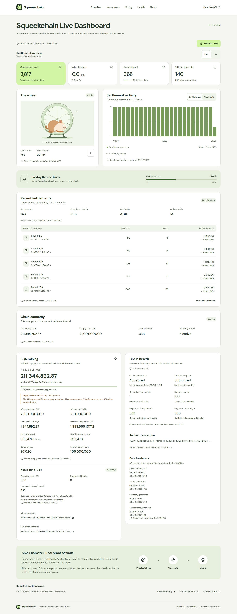

# Squeekchain Live Dashboard

An extension of the [existing Squeekchain dashboard](https://squeekchain-live-dashboard.imd.site/) and its [React + TypeScript source](https://github.com/identity-md-launches/launch-2690-build-single-page-website-called/tree/85101c4). The original sage/lime design, hamster wheel, telemetry, block progress, economy, chart controls, transaction list and 10-second refresh remain.

The complete static website is in **`dist/`**. It reads `api.squeekchain.com` directly from the browser, with no backend, account, wallet, key or environment file.



## Install, preview and rebuild

Use Node.js **22.12 or later** and npm. Validation used Node 24.21.0.

```sh
npm ci
npm run dev
```

To check and rebuild the production export:

```sh
npm run typecheck
npm test
npm run build
npm run preview
```

Open the local address printed by Vite. `npm run preview` serves the finished `dist/` export. Any static HTTP server can serve that directory without Node or dependencies. Opening the HTML through `file://` is unsupported because the site uses browser modules.

`vite.config.ts` sets `base: './'`. JavaScript, CSS, fonts, favicon and social image are local and use relative asset URLs, including when the site is served under a subpath. Navigation uses page anchors; settlement ranges use a query parameter, so neither needs server-side routing.

## The three additions

1. **SQK mining** — total minted supply compared with the specified **21B SQK reference cap**, the **2.1B premint reference**, independently labeled API cap and premint, mining-issued supply, remaining capacity, **393,470-block halving interval**, calculated next halving, bonus blocks, launch bonus, next-round state, projected mint and reported round window. Both supplied contract addresses are visible in full and link to the API-reported network's explorer when supported.
2. **Settlement window** — **24h / 7d** controls update `?range=24h|7d`. The summary metric, four totals, activity chart, exact-value table, recent transactions and source link all use the same selected response. Direct links and browser Back/Forward work; unrelated query parameters and anchors survive. The chart uses the API's bucket interval: hourly for 24h and six-hourly for the observed 7d response. It retains the settlements/work metric choice. The list shows five entries initially and can expand to all entries returned by the API.
3. **Chain health** — oracle acceptance and rejection reason, queue state, enabled/disabled and incident signals, queued and buffered rounds/work, projected round endpoint and block height, full anchor transaction, and sensor/status/economy/settlement timestamps with their ages. Reported projection values are labeled optimistic when the API says so.

**Supply discrepancy:** during validation the API reported a **2,100,000,000 SQK cap** and **210,000,000 SQK premint** at 18 decimals, one tenth of the brief's reference values. The mining meter is explicitly a comparison with the requested **21,000,000,000 reference cap**. The API's different cap and premint appear immediately below, with a discrepancy note. No API amount is rescaled to make it match the reference. `totalMintedBaseUnits` supplies the mining panel's minted total; the original economy panel still shows `liveSupplyBaseUnits`, which can be lower after burns.

Mining contract: `0x2dccb11fcc2defdd188555e45acb52231e82e218`  
SQK token contract: `0xd78a3956cf63164d1fa1c622ad3c66623162fa1e`

## Public API mapping

| Endpoint | Data used |
| --- | --- |
| [Status](https://api.squeekchain.com/v1/status) | `measurement` work, RPM, speed, core state, observation/freshness threshold; `oracle`; `settlementQueue`; `builder.anchor`, `queued` and projections; `generatedAt` |
| [24h settlements](https://api.squeekchain.com/v1/settlements?range=24h) / [7d settlements](https://api.squeekchain.com/v1/settlements?range=7d) | `range`, `summary`, `window`, `buckets`, `recentSettlements`, `mining.nextRound`, `mining.processedThroughRound`, mining decimals, `chain.chainId`, `generatedAt` |
| [Economy](https://api.squeekchain.com/v1/economy/state) | `asset`, `supply`, `schedule`, `lifecycle`, `chain`, `generatedAt` |

Only the selected settlement range is polled. All three sources load immediately, then every **10 seconds**, concurrently, with **8-second request timeouts**. **Refresh now** starts another cycle, and returning to the tab refreshes it. Duplicate cycles are blocked. A range change aborts the old cycle, clears the old settlement data and starts a new one. Late responses cannot overwrite the new range. Browser timer throttling can delay background refreshes.

Failures retain the last successful values **for that window**, label them as last received, and retry automatically. A newly selected range never borrows results from the previous range. Missing values read “Unavailable”; genuine zeroes remain zero. The API limits the recent list, so its length need not match the summary count. No synthetic readings or fixtures enter the production app.

Conversions and precision live in `src/data.ts`: RPM is `rpmMilli / 1000`; block progress uses a `1e9` fraction scale; integer/token amounts use `BigInt`. Token displays truncate to two decimals. The reference-cap percentage also truncates to two decimals. The next halving is the first interval boundary after the API's closed block height, measured from its start height. “Projected through round” uses the queue’s buffered last round, or the reported anchor when the queue explicitly contains zero rounds; it does not predict future arrivals.

Source-note update times mean **successful browser receipt**. Chain health separately shows **API-generated timestamps and sensor age**, using the sensor's stale threshold (120 seconds when absent). Freshness is a dashboard age indicator, not a chain-finality guarantee. All timestamps are UTC. Sepolia was the reported network during validation. Unknown chain IDs show full addresses/hashes without guessing an explorer.

The wheel remains an illustration. It follows fresh spinning telemetry, stops on idle/stale/failure, honors reduced motion, and has a pause control independent of polling.

## Validation

The final export was served under `/preview/` and exercised with actual API responses and deterministic failure fixtures. Dependencies were installed in an isolated `test/scratch/build` workspace for this assignment, keeping generated dependencies out of the submission.

| Check | Actual result |
| --- | --- |
| `npm --prefix test/scratch/build run typecheck` | Passed |
| `npm --prefix test/scratch/build test` | 10 tests passed |
| `npm --prefix test/scratch/build run build` | Passed; final export copied to `dist/` |
| `npm --prefix test/scratch/build run test:browser -- --project=chromium` | 17 tests passed, using an installed Chromium executable override |
| Pinned `taste.mjs --out test/scratch/taste` | 16/16 checks passed; all six Better Interface domains reviewed |
| Live production-export checks | Both ranges, manual and automatic refresh, chart metric/table, list expansion; HTTP 200 from all API endpoints; no console/script/resource errors; no axe violations |

The page reflows without horizontal overflow at **320, 390, 768, 1024 and 1440px**. The first 390 × 844 screen shows the product, refresh action, range controls and summary metrics. Keyboard selection, history, loading, errors, retry, stale data, cancelled requests, reduced motion, full addresses and 200% root text enlargement were checked.

To repeat the browser suite on a normal development machine:

```sh
npx playwright install chromium
npm run build
npm run test:browser -- --project=chromium
```

The test runner owns and stops its static preview server. `PLAYWRIGHT_CHROMIUM_EXECUTABLE` can optionally point to an existing Chromium executable. WebKit is also configured; run `npx playwright install webkit` and `npm run test:browser -- --project=webkit` where its system libraries are available.

**Limits:** WebKit downloaded but could not launch because required OS libraries were absent. Physical devices, screen readers, native browser zoom, RTL/localization and social-platform crawlers were not tested. Root text enlargement is not native zoom. Local browser validation required the machine's network proxy; no proxy settings are included in the application. API uptime and future schema changes remain external dependencies.

See [the validation and six-domain review](artifacts/validation.md), [design probe results](artifacts/design-probe.json), [live check results](artifacts/live-validation.json), [mobile first screen](artifacts/dashboard-mobile.png), and [design documentation](DESIGN.md).

## Delivery and size budget

- `src/`: UI, parsing, refresh logic, styles and original SVG artwork.
- `public/`: favicon, social image and runtime license notices.
- `dist/`: complete static production website, included alongside source and lockfile.
- `tests/`: meaningful parser and browser tests; fixtures are test-only.
- `artifacts/`: measured results, screenshots, validation and guidance licenses.
- `DESIGN.md`: final tokens, typography, components and responsive behavior.

Explicit submission path budgets: **`.gitignore` ≤ 1 KiB**, **`dist/` ≤ 1 MiB**, **`artifacts/` ≤ 5 MiB**, and **all other deliverables together ≤ 2 MiB minus the ignore-file allowance**, within the overall **8,388,608-byte maximum**. Every dependency/cache directory and `test/scratch/` has a **zero-byte submission budget**; ignore patterns cover these at every nesting level. `dist/` and `artifacts/` are intentionally included. No dependency archives, vendored registry, backend, service worker or submodule is needed. The final measured size is in the validation record.

Third-party licenses and source attribution are in [THIRD_PARTY_NOTICES.md](THIRD_PARTY_NOTICES.md).
